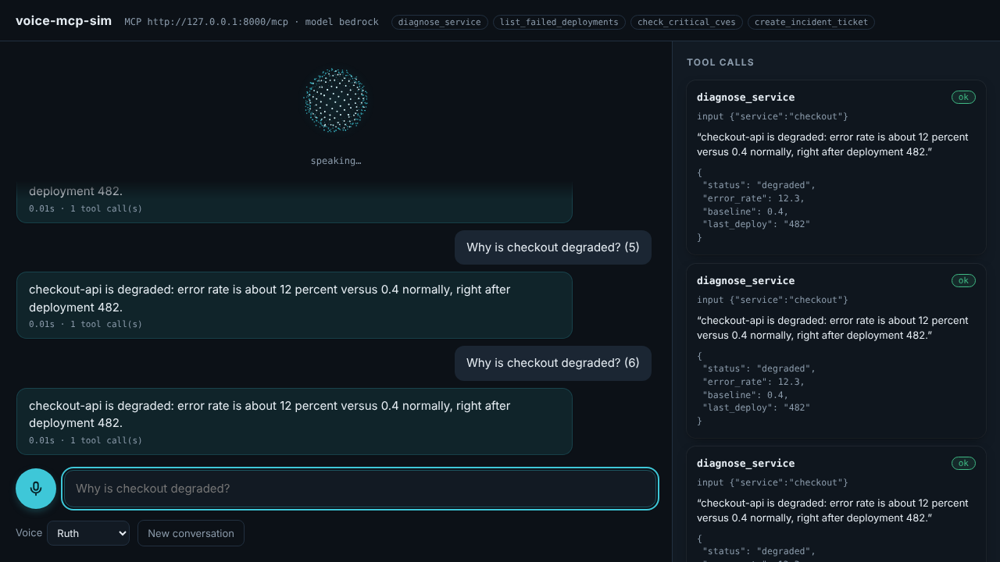

# voice-mcp-sim

**Talk to any MCP server with your voice, in the browser, with no hardware.**

voice-mcp-sim is a small, open-source voice assistant for testing
[Model Context Protocol](https://modelcontextprotocol.io) servers the way a voice
assistant such as Alexa+ would use them. You speak (or type), a
[Strands Agents](https://strandsagents.com) agent picks the tools, and the reply is
spoken back. A side panel shows every tool call with its input and result.



## Why

When you build an MCP server for a voice assistant, you need to know:

- whether the model actually picks your tools from natural speech,
- whether your answers sound right **spoken** (short, no tables),
- whether write actions wait for a spoken "yes" before running.

Testing that on a real device is slow, and often impossible before certification.
voice-mcp-sim gives you that loop on your laptop in a minute.

## Quickstart

```bash
git clone https://github.com/K4lig/voice-mcp-sim && cd voice-mcp-sim
python -m venv .venv && source .venv/bin/activate && pip install -r requirements.txt
cp .env.example .env   # set MCP_URL and a model key, then:
source .env && python -m voice_mcp_sim
```

Open http://127.0.0.1:8080, click the mic, allow microphone access, and ask something.
Typing works in any browser.

### Voice input: two engines

1. **Browser speech** (Web Speech API): live transcript while you talk. Chrome sends the audio
   to Google for this, so it fails with `network` on Brave or Opera, behind some VPNs and
   firewalls, and Firefox does not have it.
2. **Whisper on the server**: the page records your voice, stops after a short silence and the
   server transcribes it with Whisper on Groq. Needs `GROQ_API_KEY`.

The page starts with browser speech and switches to Whisper automatically the first time
browser speech fails or does not answer. The line under the input shows which engine is active.

### Voice output: pick a voice

The **Voice** menu lists natural [Amazon Polly](https://aws.amazon.com/polly/) voices (Ruth,
Matthew, Danielle, Joanna, Stephen, Gregory) when the server has AWS credentials, plus every
English voice your browser offers. Polly uses the `generative` engine when available and falls
back to `neural`. The orb moves with the real audio. Your choice is remembered in the browser.
The AWS identity needs the `polly:SynthesizeSpeech` permission.

## Configuration

| Variable | Default | What it does |
|---|---|---|
| `MCP_URL` | `http://127.0.0.1:8000/mcp` | Any MCP server speaking Streamable HTTP |
| `MCP_TOKEN` | – | Optional, sent as `Authorization: Bearer …` |
| `MODEL_PROVIDER` | `bedrock` | `bedrock`, `groq` or `ollama` |
| `GROQ_API_KEY` / `GROQ_MODEL` | – / `openai/gpt-oss-120b` | For `groq` (free key at console.groq.com) |
| `BEDROCK_MODEL_ID` / `AWS_REGION` | Claude Haiku 4.5 / `us-east-1` | For `bedrock`; uses your AWS credentials |
| `OLLAMA_MODEL` | `qwen2.5:7b` | For `ollama`; needs ~8 GB RAM |
| `WHISPER_MODEL` / `WHISPER_LANGUAGE` | `whisper-large-v3-turbo` / `en` | Server-side voice input |
| `POLLY` / `AWS_REGION` | `on` / `us-east-1` | Amazon Polly voices; set `POLLY=off` to hide them |
| `ASSISTANT_NAME` | `Assistant` | The name the assistant uses for itself |
| `SYSTEM_PROMPT_FILE` | – | Replace the built-in voice prompt |
| `HOST` / `PORT` | `127.0.0.1` / `8080` | Where the web page runs |

## How it works

```
 browser (Web Speech API)          voice-mcp-sim (Starlette)            your MCP server
 ┌──────────────────────┐  text   ┌──────────────────────────┐  MCP   ┌──────────────┐
 │ mic → speech-to-text ├────────►│ Strands Agent per session ├──────►│ tools        │
 │ speaker ◄ text-to-   │◄────────┤ + tool-call trace         │◄──────┤              │
 │          speech      │ reply   └──────────────────────────┘        └──────────────┘
 └──────────────────────┘
```

- Speech recognition runs in the browser, or on the server with Whisper when the browser cannot.
- Speech output comes from Amazon Polly on the server, or from a browser voice.
- Each browser tab gets its own agent, so multi-turn flows (like "are you sure? / yes") work.
- The built-in prompt keeps replies to one or two spoken sentences and tells the model
  never to confirm a write action unless the user said yes.

## Tips for voice-friendly MCP tools

- Return a short `speech` sentence plus structured `details`; the panel shows both.
- Mark tools with `readOnlyHint` / `destructiveHint` annotations.
- Make write tools return a preview and a confirmation code first, and only act on a
  second call with that code.

Example server: [Alexa CloudOps Copilot](https://github.com/K4lig/Alexa-CloudOps-copilot).

## Development

```bash
pytest   # runs with a fake agent and fake tools: no model, no network
```

## License

MIT
